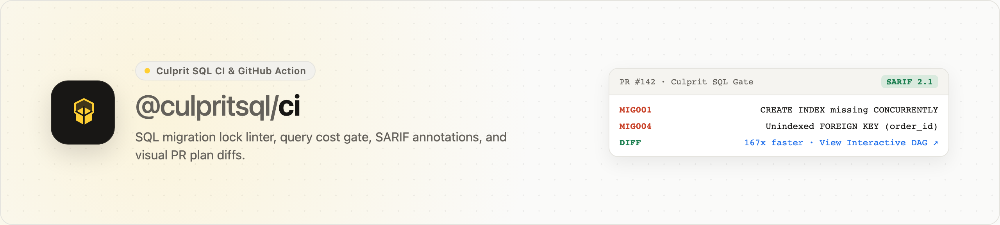

<div align="center">

<picture>
  <source media="(prefers-color-scheme: dark)" srcset="https://raw.githubusercontent.com/culpritsql/culprit-ci/main/assets/hero-dark.png">
  <source media="(prefers-color-scheme: light)" srcset="https://raw.githubusercontent.com/culpritsql/culprit-ci/main/assets/hero-light.png">
  
</picture>

<br />

[](https://www.npmjs.com/package/@culpritsql/ci)
[](https://github.com/culpritsql/culprit-ci/releases/latest)
[](https://docs.github.com/en/code-security/code-scanning/integrating-with-code-scanning/sarif-support-for-code-scanning)
[](https://www.npmjs.com/package/@culpritsql/plans)
[](./LICENSE)

**Catch lock-amplifying SQL migrations, unindexed foreign keys, non-sargable queries, and execution plan regressions before they reach production.**

[Culprit Explain](https://explain.culpritsql.com) · [GitHub Action Quickstart](#github-action-quickstart) · [CLI Usage](#cli-quickstart) · [Rule Reference](#rule-reference) · [Programmatic API](#programmatic-api)

</div>

---

## Why `@culpritsql/ci`?

- **Lexer-Accurate SQL Migration & Query Linter:** Tracks `--` line comments, nested `/* ... */` block comments, `'...'` literals, and `$tag$...$tag$` dollar-quoted PostgreSQL bodies with exact 1-based line and column spans.
- **Zero Same-File False Positives:** Tracks `CREATE TABLE <name>` inside each migration file so indexing or altering a brand-new empty table never triggers false blocking-DDL alarms (`MIG001`, `MIG003`, `MIG006`).
- **Local WebAssembly Execution Plan Gate:** Powered by [`@culpritsql/plans`](https://www.npmjs.com/package/@culpritsql/plans) (Rust compiled to WebAssembly). Parses and structurally diffs PostgreSQL, SQL Server (`.sqlplan`), MySQL, MariaDB, YugabyteDB, and SQLite plans locally with zero network calls.
- **One-Click Redacted Diff Links:** Generates client-side `https://explain.culpritsql.com/#s=z1...` deep links (`deflate-raw` + base64url) with SQL string and numeric literals scrubbed automatically.
- **Native GitHub PR Workflow:** Emits valid **SARIF 2.1.0** for inline PR diff annotations via `upload-sarif@v3` and maintains a single sticky Pull Request summary comment.

---

## GitHub Action Quickstart

Add `.github/workflows/sql-ci.yml` to lint migrations, compare baseline vs candidate plans, upload inline SARIF annotations, and post a sticky Pull Request report:

```yaml
name: SQL CI

on:
  pull_request:
    paths:
      - "migrations/**"
      - "src/**/*.sql"
      - "plans/**"

permissions:
  contents: read
  pull-requests: write
  security-events: write

jobs:
  culprit:
    runs-on: ubuntu-latest
    steps:
      - uses: actions/checkout@v4

      - name: Run Culprit SQL CI
        id: sql-gate
        uses: culpritsql/culprit-ci@v0.5.11
        continue-on-error: true
        with:
          sql: "migrations/*.sql"
          queries: "src/**/*.sql"
          engine: "postgres"
          before-plan: "plans/before.json"
          after-plan: "plans/after.json"
          fail-on: "high"
          sarif-file: "culprit.sarif"
          post-comment: "true"

      - name: Upload SARIF inline annotations
        uses: github/codeql-action/upload-sarif@v3
        with:
          sarif_file: culprit.sarif

      - name: Enforce SQL gate
        if: steps.sql-gate.outputs.passed != 'true'
        run: exit 1
```

---

## CLI Quickstart

Run directly with `npx`, `bunx`, or install in `devDependencies`:

```bash
# Lint PostgreSQL migrations + application queries and write SARIF + PR Markdown
npx @culpritsql/ci \
  --sql "migrations/*.sql" \
  --queries "src/**/*.sql" \
  --engine postgres \
  --fail-on high \
  --sarif culprit.sarif \
  --markdown-out comment.md

# Gate a single execution plan and compare Before vs After plans
npx @culpritsql/ci \
  --plan plans/checkout.json \
  --compare plans/before.json plans/after.json \
  --max-cost 5000 \
  --format markdown
```

### Exit Codes

| Code | Meaning |
| :--- | :--- |
| `0` | Gate passed (no findings at or above `--fail-on` and no plan regression) |
| `1` | Gate failed (`findings >= --fail-on` or execution plan regressed) |
| `2` | Invalid CLI arguments or unreadable input file |

---

## Rule Reference

### Migration Rules (`MIG*`)

| Rule | Severity | Engines | What It Catches & Recommended Fix |
| :--- | :--- | :--- | :--- |
| `MIG001` | `high` | Postgres, MSSQL, MySQL | `CREATE [UNIQUE] INDEX` on an existing table without `CONCURRENTLY` (Postgres), `WITH (ONLINE = ON)` (SQL Server), or `ALGORITHM=INPLACE, LOCK=NONE` (MySQL). Automatically skips tables created via `CREATE TABLE` in the same migration file. |
| `MIG002` | `high` | Postgres | `CREATE/DROP INDEX CONCURRENTLY` placed inside an explicit `BEGIN` / `START TRANSACTION` block (fails at runtime in PostgreSQL). |
| `MIG003` | `high` | Postgres, MSSQL, MySQL | `ALTER COLUMN ... TYPE` / `MODIFY COLUMN` table rewrite, or `ADD COLUMN ... NOT NULL` on an existing table without a safe constant `DEFAULT` (or with volatile functions like `gen_random_uuid()` / `random()`). |
| `MIG004` | `medium` | All | `FOREIGN KEY (col)` or `REFERENCES` added without a covering `CREATE INDEX`, `PRIMARY KEY`, or `UNIQUE` constraint in the migration or `--schema` snapshot. |
| `MIG005` | `high` | All | `DROP TABLE`, `ALTER TABLE ... DROP COLUMN`, or `TRUNCATE` without `-- culprit-ignore: MIG005`. Ignores safe `DROP CONSTRAINT` and `DROP NOT NULL` clauses. |
| `MIG006` | `low` | Postgres, MSSQL | DDL modifying an existing table without `SET lock_timeout` (Postgres) or `SET LOCK_TIMEOUT` (SQL Server) earlier in the migration. |

### Query Rules (`QRY*`)

| Rule | Severity | Engines | What It Catches & Recommended Fix |
| :--- | :--- | :--- | :--- |
| `QRY001` | `high` | All | `UPDATE` or `DELETE` statement with no top-level `WHERE` clause (accurately flags statements whose only `WHERE` lives inside a scalar subquery). |
| `QRY002` | `medium` | All | Non-sargable function wrapping a column in `WHERE` (`LOWER(col) =`, `UPPER(col) =`, `DATE(col) =`, `YEAR(col) =`, `CAST(col AS ...) =`). |
| `QRY003` | `low` | All | Leading wildcard `LIKE '%...'` or `ILIKE '%...'` predicate preventing standard B-tree index range seeks. |

### Execution Plan Rules (`PLAN*`)

| Rule | Severity | What It Catches |
| :--- | :--- | :--- |
| `PLAN001` | `medium` | Full table scan (`Seq Scan`, `Table Scan`, `Clustered Index Scan`) when `--allow-seq-scan` is not set. |
| `PLAN002` | `high` | Sort, Hash, or Exchange operator spilling temporary pages to disk. |
| `PLAN003` | `high` / `medium` | Bottleneck insights surfaced by `@culpritsql/plans` (key lookups, misestimates, implicit conversions). |
| `PLAN004` | `high` | Total optimizer plan cost exceeding `--max-cost`. |
| `PLAN005` | `high` | Structural, runtime, cost, or warning regression between `--compare <before> <after>` plans. |

### Inline Suppression Pragmas

Suppress specific rules on an intentional statement or across a whole file:

```sql
-- Suppress on the next statement:
-- culprit-ignore: MIG005
DROP TABLE legacy_sessions_2024;

-- Or inline on the same line:
TRUNCATE TABLE staging_import; -- culprit-ignore: MIG005, MIG006

-- Suppress across an entire file:
-- culprit-ignore-file: MIG006
```

---

## PR Comment & SARIF Preview

### Sticky Pull Request Comment (`formatMarkdown`)

> ## Culprit SQL CI: Passed
>
>  **High:** 0 | **Medium:** 1 | **Low:** 0 | **Files Checked:** 3 | **Fail Threshold:** `high`
>
> ### Execution Plan Diff (Verified)
> - **Comparison:** `before.json` -> `after.txt` (`postgres`)
> - **Verdict:** **3467.4x lower cost (53813.63 -> 15.52)**
>
> [Open Interactive Diff in Culprit Explain](https://explain.culpritsql.com/#s=z1...)
>
> ### Findings
> | File:Line | Rule | Severity | Issue & Fix |
> | :--- | :--- | :--- | :--- |
> | `migrations/004_fk.sql:3:3` | `MIG004` | MEDIUM | Foreign key on 'invoices (account_id)' has no covering index in this migration or schema snapshot. **Fix:** Create an index with leading column(s) (account_id) on 'invoices' to avoid lock amplification and full scans on parent updates/deletes. Suggested SQL: `CREATE INDEX CONCURRENTLY idx_invoices_account_id ON invoices (account_id);` |

### SARIF 2.1.0 Code Scanning Output (`formatSarif`)

```json
{
  "$schema": "https://json.schemastore.org/sarif-2.1.0.json",
  "version": "2.1.0",
  "runs": [
    {
      "tool": {
        "driver": {
          "name": "Culprit CI",
          "version": "0.5.11",
          "rules": [{ "id": "MIG001", "defaultConfiguration": { "level": "error" } }]
        }
      },
      "results": [
        {
          "ruleId": "MIG001",
          "level": "error",
          "locations": [
            {
              "physicalLocation": {
                "artifactLocation": { "uri": "migrations/002_idx.sql", "uriBaseId": "%SRCROOT%" },
                "region": { "startLine": 2, "startColumn": 1, "endLine": 2, "endColumn": 52 }
              }
            }
          ]
        }
      ]
    }
  ]
}
```

---

## Programmatic API

```ts
import {
  lintSql,
  analyzePlanGate,
  comparePlanGate,
  runCiGate,
  formatSarif,
  formatMarkdown,
} from "@culpritsql/ci";

const findings = lintSql(
  "CREATE INDEX idx_orders_email ON orders (email);",
  { file: "migrations/002_idx.sql", engine: "postgres" },
);

const diffGate = await comparePlanGate(beforePlanJson, afterPlanJson, {
  beforeName: "main",
  afterName: "PR #42",
});
console.log(diffGate.verdictSummary, diffGate.explainUrl);
```

---

## License

MIT. See [LICENSE](./LICENSE).
